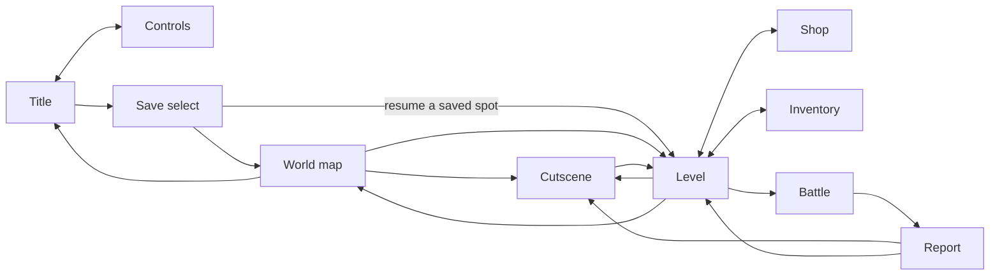

# Hero of the Overworld

A small but **extensible** turn-based JRPG written in Rust. Travel a world map,
explore tile-mapped levels, dodge (or fight) roaming monsters, and win data-driven
turn-based battles, then watch a scripted cutscene recruit a new party member.

- **Engine:** [`macroquad`](https://macroquad.rs), one small crate for the window, GL
  rendering, input, text, and audio, on both native (OpenGL) and web (WebGL)
- **Web build:** `cargo build --target wasm32-unknown-unknown` produces a single
  `hero.wasm` loaded by macroquad's JS bundle (no wasm-bindgen or Trunk)
- **Audio:** looping background music via [`macroquad::audio`](https://docs.rs/macroquad/latest/macroquad/audio/)
  (native and web)
- **Content:** plain-text [RON](https://github.com/ron-rs/ron) files, one per entity, plus
  CSV tilemaps. Add heroes, enemies, skills, items, levels, shops, and cutscenes without
  touching engine code
- **Saves:** progress autosaves into one of **three save slots** (pick or start a
  playthrough on the save-select menu) in a small custom binary format: a file per
  slot (via [`dirs`](https://crates.io/crates/dirs)) natively, IndexedDB on the web
- **Tests:** fast data/logic tests plus a real end-to-end suite that drives the actual game
  window with [`rustautogui`](https://crates.io/crates/rustautogui) (keyboard input,
  screenshots, and template matching)

---

## Play

- **In your browser:** https://playforge-coding.github.io/hero-of-the-overworld/play/
  (published to GitHub Pages by [`.github/workflows/docs.yml`](.github/workflows/docs.yml)).
- **Prebuilt binaries:** self-contained Windows/macOS/Linux builds are attached to
  each [tagged release](https://github.com/playforge-coding/hero-of-the-overworld/releases)
  by [`.github/workflows/release.yml`](.github/workflows/release.yml).
- **From source:** see below.

## Running

The toolchain is pinned in [`rust-toolchain.toml`](rust-toolchain.toml) (Rust 1.99.1,
edition 2024), so `rustup` installs the right compiler and the wasm target on first build.

### Native

```bash
cargo run            # debug
cargo run --release  # smooth
```

### Web

```bash
cargo build --release --target wasm32-unknown-unknown --bin hero
# then serve index.html, hero.wasm, and mq_js_bundle.js, plus the JS glue
# sapp_jsutils.js, hoto_storage.js, and hoto_gamepads.js (see docs/getting-started)
```

The wasm module imports functions that the page supplies at load time, so
[`.cargo/config.toml`](.cargo/config.toml) passes `--allow-undefined` to the wasm linker.

Controls: **arrows or WASD** move, **Enter, Z, or Space** confirm, **Esc, X, or Backspace**
cancel or leave a level, and **Shift or C** (Menu) opens the inventory in a level (or the
controls screen on the title). A **gamepad** works too, on desktop *and* in the
browser: D-pad or stick to move, A to confirm, B to cancel. Plug in several and each
controls a party member in battle (assign keyboard and pads to players on the title's
CONTROLS screen). On a **touchscreen** (phones, the web build), on-screen controls
appear after the first touch: a floating joystick in the overworld, a d-pad in
menus, and up/down in battle. See
[`docs/controls.md`](docs/controls.md).

Press Enter on the title to reach the **world map**, pick a level, and enter it. You walk
the tiled overworld freely; roaming enemies chase you inside an aggro radius and start a
**battle** on contact, but you move faster than they do, so encounters can be dodged. In
battle your **active line-up of up to three heroes** each chooses **ATTACK**, a
**SKILL**, an **ITEM**, or **DEFEND**, then everyone acts in speed order. The roster
can grow past three as you recruit (a **cutscene** ally, or even a **boss you beat and
then recruit**); extra heroes wait in reserve and swap into the line-up from the party
menu. Hits can **miss** or land a **critical**
for extra damage, and each hero's **weapon and armor** tilt those odds. **Items** are
consumables (potions, bombs, stat tonics) spent from a shared stash, bought at shops or
dropped by beaten foes. Walk up to a **shopkeeper** on the map to step into a store and
spend battle winnings on new gear and items. Screens also hide **treasure chests** to open
for gold, items, and gear. In the deep regions some of them are **mimics** drawn from the
very same chest sprite, so you can't tell them apart until you get close and one springs a
fight where it hurls fireballs and copies your party's own moves. Clear every demon in a
level to **unlock the next** and get **carried straight into it**, since progression is
linear. Your party, clears, per-level progress, and your **exact position in a level** are
**saved automatically** and resume on the next launch.

---

## Architecture

Everything is drawn in a **virtual canvas**, a fixed 180px tall, with a width that
tracks the window's aspect ratio (320 to 480px) so wide screens (a phone in landscape)
reveal more of the world instead of black side bars. A `Camera2D` maps it straight to
the window, so game code never deals with real pixels or DPI.

| Module | Responsibility |
| --- | --- |
| [`src/renderer.rs`](src/renderer.rs) | thin macroquad wrapper: a virtual-resolution sprite/rect/text draw queue, aspect-adaptive width, letterboxed |
| [`src/data.rs`](src/data.rs) | content file formats, the split-file loader, and indexed registries |
| [`src/party.rs`](src/party.rs) | the persistent, extensible party (HP/MP/XP carried between battles), plus the shared gear bag and consumable-item stash |
| [`src/inventory.rs`](src/inventory.rs) | the out-of-battle party menu: equip and unequip gear, plus use healing items and moves on the map |
| [`src/input_config.rs`](src/input_config.rs) | the controls screen: map keyboard and gamepads to players for local co-op |
| [`src/devtools.rs`](src/devtools.rs) | **debug-only** developer menu (F1 on the map): set party level, add any character, fight any encounter |
| [`src/overworld.rs`](src/overworld.rs) | tile-mapped levels: screens, walking, camera, roaming enemies, chests and mimics, townsfolk and houses |
| [`src/battle.rs`](src/battle.rs) | the turn-based battle scene (commands, then AI, then resolution) |
| [`src/shop.rs`](src/shop.rs) | the shop interior scene: walk-in store plus the buy-and-equip and buy-item UI |
| [`src/cutscene.rs`](src/cutscene.rs) | data-driven scripted dialogue and party recruitment, choreographed over the live map (cast actors walk, turn, exit) |
| [`src/audio.rs`](src/audio.rs) | background music via `macroquad::audio` (native and web) |
| [`src/save.rs`](src/save.rs) | custom binary save format and per-slot storage (native file via `dirs`, web IndexedDB) |
| [`src/game.rs`](src/game.rs) | the scene state machine (see the diagram below) |
| [`src/input.rs`](src/input.rs) | logical buttons polled from the keyboard, gamepads (`gilrs` natively, the browser Gamepad API on web), and on-screen touch controls each frame; maps input sources to players |
| [`src/app.rs`](src/app.rs) | the macroquad main loop and window config |

The main scenes `game.rs` moves between (the debug-only developer menu hangs off the map):



The `Renderer` keeps the same small API the game modules were written against (a queue of
`draw_rect` / `draw_sprite` / `draw_text` calls replayed each frame), so the rendering
backend swapped from a custom wgpu engine to macroquad without touching any game logic.

Assets (sprite sheets, tile art, font, music) are **embedded at compile time**, so the
native and web builds load content through the exact same path with no async asset fetching.
Single files use `include_bytes!`; the `assets/data/` tree and the house tileset are embedded
as whole folders with [`rust-embed`](https://crates.io/crates/rust-embed), and
[`build.rs`](build.rs) watches those folders so adding a file triggers a rebuild.

### Text

Text uses macroquad's built-in TrueType rasterizer with the embedded pixel font
`assets/textures/ui/font.ttf`. Glyphs are drawn *after* the low-res scene is scaled up, at
the final on-screen size, so the UI text stays crisp rather than being magnified from a
tiny atlas.

---

## Extending the game (data-only)

All content lives under [`assets/data/`](assets/data), with **one file per entity**
(`enemies/<id>.ron`, `skills/<id>.ron`, `levels/<id>.ron`, and so on) and each stage's
tilemaps as `maps/<level>/<screen>.csv` (see the [modding guide](docs/modding.md)). To add
a **new party member** or **enemy** you usually just drop in one file. A character can use
its own sprite sheet (the bundled mage, ELARA, has her own purple `mage.png`) or reuse and
recolor an existing one with a `tint`. Here is `characters/mage.ron`:

```ron
CharacterDef(
    id: "mage",
    name: "ELARA",
    stats: Stats(max_hp: 78, max_mp: 60, attack: 10, defense: 9, magic: 26, speed: 13),
    sprite: BattlerSprite(
        texture: "mage",                 // any key registered in src/data.rs::embedded_texture
        frame_w: 16, frame_h: 16,
        draw_w: 48.0, draw_h: 48.0,
        // tint: Some((150, 100, 220)),  // optionally recolor a shared sheet instead
        idle:   AnimClip(row: 2, first_col: 0, frames: 4, fps: 5.0),
        attack: AnimClip(row: 7, first_col: 0, frames: 5, fps: 14.0),
    ),
    skills: ["firebolt", "frost", "mend"],
),
```

Add the id to `starting_party` to have it join at the start, or recruit it mid-game from a
cutscene `Recruit` step (that's how ELARA joins after GREENWOOD is cleared). The battle
system iterates whatever heroes are present, so a **second or third character assisting in
battle needs no engine changes**, since the party is just a `Vec`.

Adding genuinely new art is the only code touch: register the PNG once in
[`embedded_texture`](src/data.rs) so it ships inside the wasm bundle too.

The data files also define:

- **skills**: physical, magical, or heal, single or all targets, each with a description and
  an optional **attack animation** (a lunge, a flying **projectile**, or a screen-wrapping
  **charge**). A character knows some from the start and unlocks others through a
  level-gated **learnset**.
- **equipment**: weapons and armor with stat bonuses, crit, accuracy, evasion, and
  descriptions. Heroes and enemies equip them by id.
- **items**: consumables with a target and a composable effect (heal, damage, restore MP,
  inflict a status), used in battle, bought, or dropped.
- **enemies**: stats, skills, AI, XP and gold rewards, and a chance-based item **drop**
  table. Optional markers add a **tool** (an inert siege engine like the ballista, worked by
  the enemies beside it and crumbling once none remain), **mimicry** (a mimic copies the
  party's last move, wearing that hero's shape as it strikes), and an **invincible** flag
  for scripted, unwinnable bosses like the Demon King.
- **encounters**: named groups of enemies, optionally a **boss** fight or one whose
  **defeat** plays a cutscene and advances the story **chapter**.
- **levels**: a map marker, a **chapter**, per-level **ground / wall / tree** textures to
  re-theme a region (sand and coconut palms for a beach, dark brick for a keep), and a set
  of connected tile screens with enemy spawns, shop entrances, **treasure chests**,
  disguised **mimics**, **townsfolk**, and **houses**. A screen with no spawns anywhere is a
  peaceful **town**.
- **shops**: a keeper, a facing/exit wall, and priced wares (gear or items).
- **npcs**: talkable townsfolk with an emote bubble and dialogue, some of them a one-time
  scene that **recruits** them.
- **cutscenes**: scripted dialogue lines and recruits.

### The sprite sheets

The battler sheets are grids of 16x16 frames:

- `swordsman.png` is 5x12. Rows 0-3 walk (down/up/right/left), rows 4-7 attack.
  The overworld walk uses rows 0-3; the battler uses the *walk-right* row as its idle and
  the *attack-right* row when striking.
- `mage.png` is 6x8 (ELARA). Rows 0-3 walk (4 frames), rows 4-7 cast (5 frames). The cast
  rows are ordered down/up/*left/right*, which swaps left and right compared with the walk
  rows.
- `demon.png` is 6x8, with the same convention as the swordsman; the roaming overworld
  demon uses the walk rows.

Tiles (`grass`, `water`, `tree`, `rock`, `barricade`) are their own 16x16 PNGs under
`assets/textures/tiles/`.

---

## Tests

Two layers:

**1. Fast data/logic tests** need no display. They validate that every content file parses,
every skill/enemy/encounter/texture/cutscene/shop/item/drop cross-reference resolves, that
every level's screens are linked and traversable, that shop wares and keeper placements are
valid, that chest loot and mimic encounters resolve on standable ground, that the shop
interior and buy logic behave (gear *and* items), that the party mechanics (build, recruit,
level-up) behave, that save files round-trip, and that renamed level and cutscene ids still
resolve for old saves.

```bash
cargo test --lib --test data
```

Plain `cargo test` runs these too, but it also builds the e2e suite (its tests are skipped
unless asked for), and that build links `libXtst`. On a machine without the X11 development
packages (`libxtst-dev` on Debian/Ubuntu), use the command above.

**2. End-to-end GUI tests (`rustautogui`)** drive the *real* game window. They launch the
binary in "test mode" (`HOTO_TEST_WINDOW=1`), give each launch its own empty save folder
(`HOTO_SAVE_DIR`, which the game honors on every OS), send keyboard input, take
screenshots, and assert on the result, including
**template-matching the hero and slime sprites on screen**. Because they take over the
screen, they are marked `#[ignore]` and run explicitly on a virtual 960x540 X display:

```bash
xvfb-run -a -s "-screen 0 960x540x24" cargo test --test e2e -- --ignored --test-threads=1
```

The screen has to be exactly 960x540: with no window manager the game keeps its default
960x540 window, which then covers the whole display and receives every key press, and the
sprite templates in `tests/fixtures/` were captured at that size. Besides Xvfb they need the
`libX11`/`libXtst` runtime libs. What they check:

| Test | Asserts |
| --- | --- |
| `boots_and_survives` | window, macroquad, data, and textures come up without panicking |
| `title_screen_renders_content` | the title actually renders (not a blank frame) |
| `enter_map_then_level_via_cutscene` | title, save-select, map, intro cutscene, then the tiled level, with each transition visibly changing the screen |
| `walking_into_slime_starts_battle` | walking into a roaming enemy starts a battle; hero and slime sprites are found on screen via template match |
| `enter_shop_and_buy` | walk to the keeper, enter the shop, walk to the counter, open the buy menu, and try to buy an item, with each step visibly changing the screen |

> A subtle bug the e2e suite caught: automation tools deliver a key press and release within
> a single frame, so classic `down && !previous` edge detection (sampled once per update)
> misses them. [`input.rs`](src/input.rs) latches presses as events arrive, which fixes both
> the tests and any fast real input.

---

## Project layout

```
assets/
  data/                             # the content database, one file per entity
    meta.ron                        #   starting party and level progression order
    characters/ enemies/ skills/    #   plus statuses/ equipment/ items/ shops/
    npcs/ encounters/ cutscenes/    #   townsfolk appearances, enemy groups, scenes
    levels/                         #   one <id>.ron per def
    maps/<level>/<screen>.csv       #   each stage's tilemaps as CSV
  textures/entities/playables/      # party sprite sheets
  textures/entities/monsters/       # enemy sprite sheets
  textures/entities/npcs/           # shopkeeper and other NPC sprites
  textures/tiles/                   # overworld and shop tile art
  textures/ui/font.ttf              # embedded UI font (TrueType)
  music/title.ogg                   # looping title theme (embedded)
  music/battle.ogg                  # looping battle theme (embedded)
  music/boss.ogg                    # looping boss theme (embedded)
src/                                # engine and game (see table above)
tests/
  data.rs                           # fast, display-free
  e2e/main.rs                       # rustautogui GUI suite
  e2e/common.rs                     # shared e2e helpers
  fixtures/                         # sprite templates for matching (captured at 960x540)
build.rs                            # rebuilds when embedded asset folders change
.cargo/config.toml                  # wasm linker flags for the web build
rust-toolchain.toml                 # pinned Rust version
docs/ and mkdocs.yml                # player-facing docs site (Zensical / Material)
index.html                          # macroquad web page (loads hero.wasm)
sapp_jsutils.js, hoto_storage.js    # web save glue (byte marshalling and IndexedDB)
hoto_gamepads.js                    # web gamepad support (browser Gamepad API)
```

## Credits

- **Sprites:** [MiniWorld Sprites](https://opengameart.org/content/miniworld-sprites)
  by [Shade](https://opengameart.org/users/shade-1) on OpenGameArt.org (CC0).
- **Title music:** by [bart](https://opengameart.org/users/bart) on OpenGameArt.org (CC BY 3.0).
- **Boss music:** by [ATMANAN](https://opengameart.org/users/atmanan) on OpenGameArt.org (CC BY 4.0).

## License

**AGPL-3.0-only**. See [LICENSE](LICENSE).
